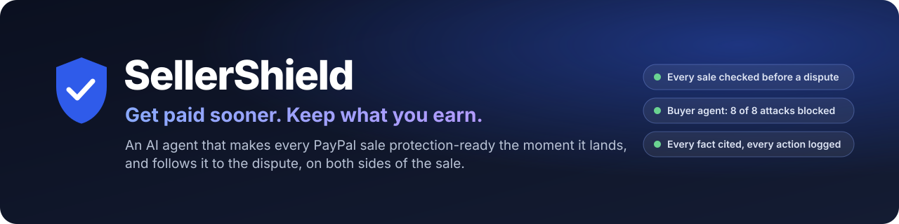
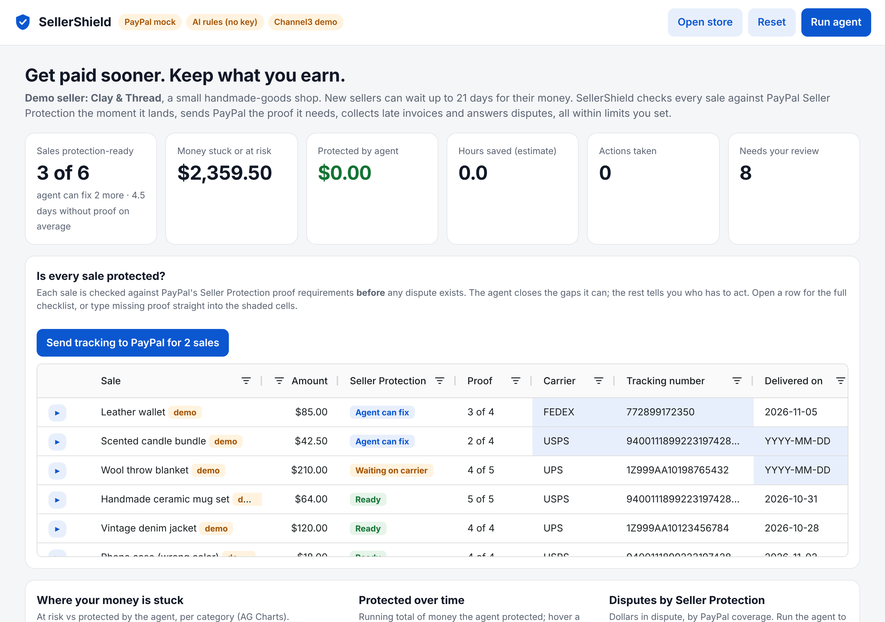
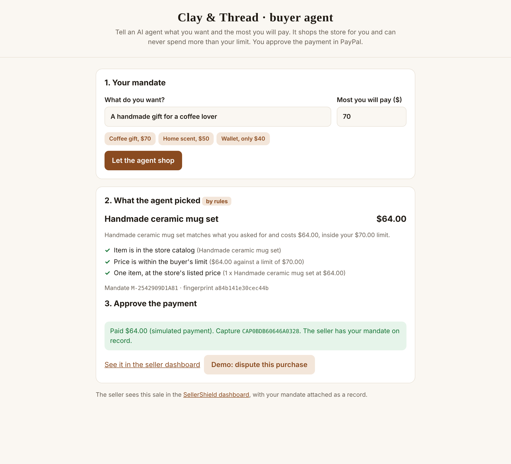
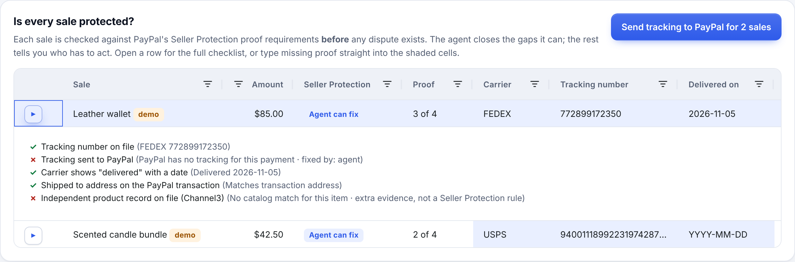
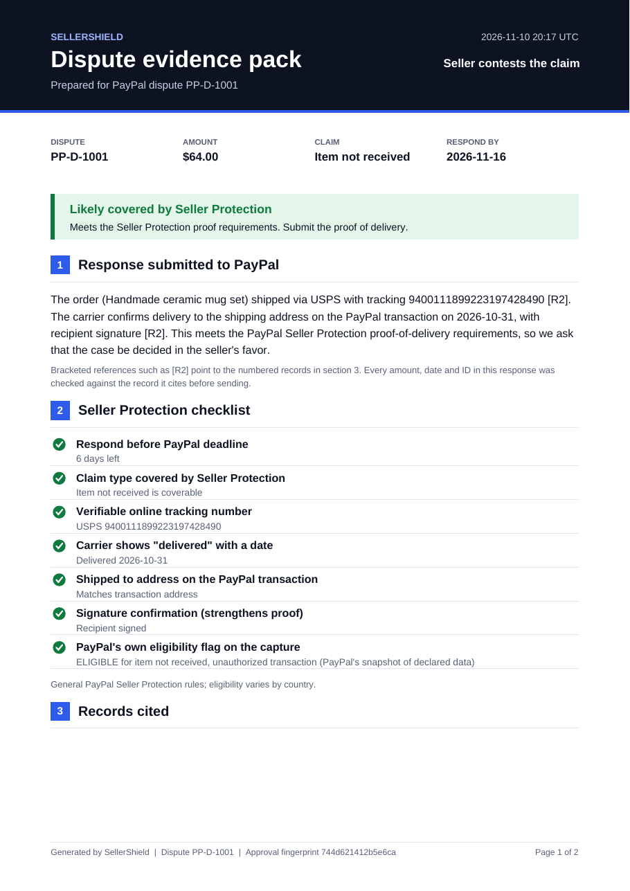
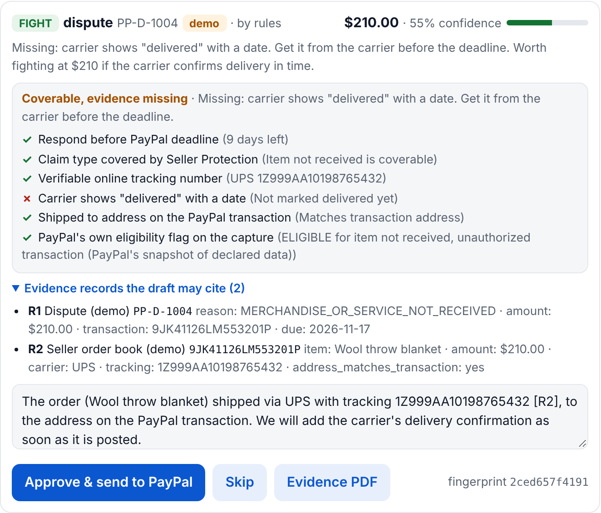
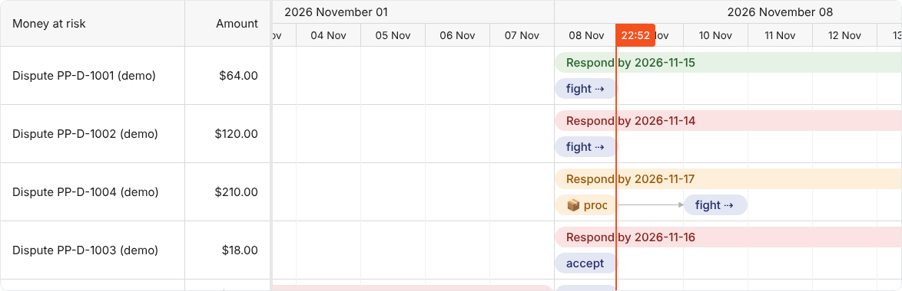
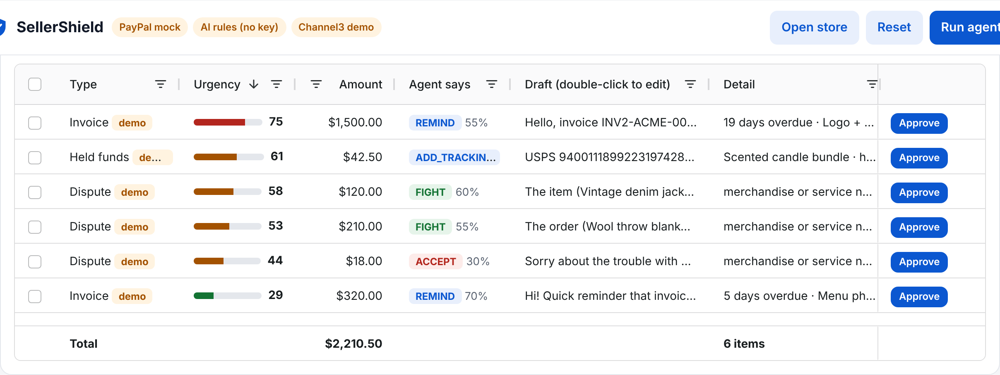
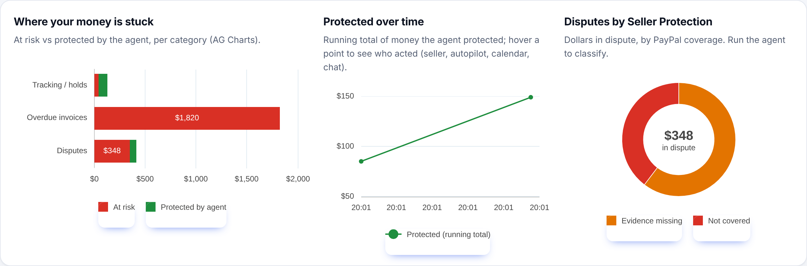
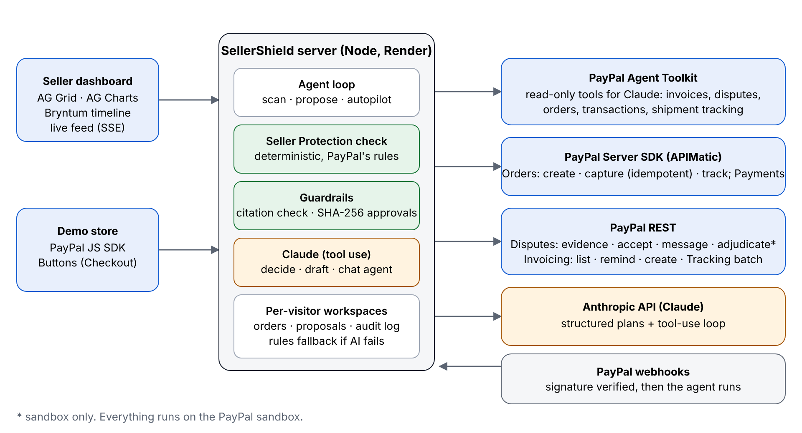

# SellerShield



[](https://github.com/mahak867/sellershield/actions/workflows/test.yml)    

**[Live demo](https://sellershield-7qfd.onrender.com)** · **[Guided tour](https://sellershield-7qfd.onrender.com/?tour=1)** · **[Buyer agent](https://sellershield-7qfd.onrender.com/buyer.html)** · **[Results](RESULTS.md)** · **[How it maps to the judging criteria](#how-it-maps-to-the-judging-criteria)**

**Get paid sooner. Keep what you earn.** An AI agent that makes every PayPal sale protection-ready the moment it lands, collects late invoices and answers disputes, within limits the seller sets.

**Live demo:** https://sellershield-7qfd.onrender.com (PayPal sandbox; the first load after idle can take about a minute)



## The problem, in PayPal's own words

- **Holds:** "Your funds are usually held for up to 21 days." The first step PayPal lists to avoid that delay is "Uploading tracking information of our supported carriers or printing a shipping label through PayPal." ([PayPal: funds on hold](https://www.paypal.com/au/brc/article/funds-on-hold))
- **Disputes:** Seller Protection doesn't cover buyer claims for items received that are "Significantly Not As Described". Item-not-received claims need proof of delivery to the address on the transaction. ([PayPal: Seller Protection](https://www.paypal.com/ca/brc/article/seller-protection), [Seller Protection policy](https://www.paypal.com/legalhub/seller-protection))
- **Unpaid invoices:** in Bonsai's analysis of 100,000+ freelancers, 29% of invoices were paid late ([Bonsai](https://www.hellobonsai.com/blog/late-freelance-payment)).

So a small seller has to know which disputes PayPal will cover, get tracking onto PayPal before trouble starts, and chase late invoices, all while running the business.

## Who it's for

Small sellers who take payments with PayPal on their own site or through invoices: a maker shop, a one-person store, a freelancer. They have no chargeback team and no finance staff, and three things cost them money:
- a new seller's funds held for weeks, until PayPal has proof the order arrived;
- buyer disputes they don't have time to answer well before the deadline;
- invoices that get paid late.

The demo seller is **Clay & Thread**, an illustrative small handmade-goods shop.

## What SellerShield does

Most seller tools start working after a buyer has opened a dispute. By then the proof is either on PayPal or it isn't. SellerShield starts at the sale:

- **Every sale is checked against Seller Protection the moment it lands**, before any dispute exists. The dashboard shows how many sales are protection-ready and who has to act on the rest: the agent, the carrier or the seller.
- **The agent closes the gaps it can.** It sends tracking to PayPal, which PayPal lists as the first step to avoid a payment hold and which is the proof an "item not received" claim needs.
- **Late invoices are collected** with reminders matched to how late they are.
- **Disputes that still arrive** are answered from records that are already in place.
- **Agent-made purchases are defensible.** A buyer's AI agent can shop the store inside a spending limit, and the buyer's instructions travel with the sale as evidence.

One autopilot policy and one audit log cover all of it.

## The three pages

| Page | Who it is for | What happens there |
|---|---|---|
| **Seller dashboard** (`/`) | The seller | Sale readiness, agent proposals, autopilot, calendar, audit log, chat |
| **Store** (`/shop.html`) | A buyer | A small shop, Clay & Thread, with real PayPal Checkout in the sandbox |
| **Buyer agent** (`/buyer.html`) | A buyer's AI agent | The agent shops the store inside a mandate; the buyer approves the payment in PayPal |

## How to judge in 5 minutes

**Fastest way:** click **Guided tour** in the dashboard header (or open `/?tour=1`). It walks the real demo in 11 steps, pressing the real buttons for you.

1. Open the [live demo](https://sellershield-7qfd.onrender.com). Your browser gets its own isolated workspace, so other judges can't reset or approve your items.
2. Look at **Is every sale protected?** Each sale is already checked against Seller Protection. Open a row to see every rule, what is missing and who fixes it.
3. Click **Send tracking to PayPal**. The **Sales protection-ready** number goes up.
4. Click **Run agent**. Every dispute, overdue invoice and sale gets one proposal. In a dispute card, type a made-up date into the draft: sending is blocked until every fact cites a record.
5. Turn on **Autopilot** (max $100, 80%), then click **Simulate dispute**. The **Live activity** feed shows the agent acting inside the limits.
6. Click **Story** on any sale to follow it from payment to dispute.
7. Click **Buyer agent**. Let the agent shop with the "Wallet, only $40" mandate (it buys nothing), then the "Coffee gift, $70" mandate, and approve the payment. Back in the dashboard the sale is tagged **buyer agent**. Then click **Run all 8 attacks** under "Try to break it".
8. Click **Open store** and buy something with a PayPal sandbox buyer account. The sale appears in the dashboard as **Agent can fix**.
9. Open the **Agent audit log**: each action shows who triggered it, which PayPal API it used, and whether the call was **live** or **simulated**.

Disputes tagged **demo** are sample data, and actions on them are simulated. A real sandbox dispute (see "Real dispute, end to end" below) is handled live.

## How it maps to the judging criteria

| Criterion | Where to see it |
|---|---|
| **Technological implementation** | Real PayPal sandbox calls across Disputes, Invoicing, Orders v2, Tracking, Webhooks (signature-verified), the Agent Toolkit and APIMatic's PayPal Server SDK, each named in the audit log with **live** or **simulated**. Claude with structured outputs and strict tools, validated in code with a rule-based fallback. 157 tests (about 83% line coverage of the library modules), a 30-step browser test in CI. See [Results](RESULTS.md). |
| **Design** | One product across three pages (seller dashboard, store, buyer agent), light and dark themes, a guided tour, an evidence PDF, and an accessibility audit in CI. |
| **Potential impact** | Starts at the sale, not the dispute: the proof PayPal asks for is on PayPal before trouble starts. One autopilot policy covers held funds, late invoices and disputes, so a seller with no staff can delegate safely. |
| **Innovation** | Both sides of one sale handled by agents: a buyer's agent shops inside a mandate it cannot be talked out of, and if the buyer disputes the purchase, the seller's response cites the mandate and works out whose mistake it was. Drag a proposed action onto a calendar day to approve it. |
| **Presentation** | Click **Guided tour**: the real demo in 11 steps, pressing the real buttons. |

## Features

### Protecting every sale

- **Protection-ready check on every sale:** `assessReadiness` in `lib/protection.js` runs the Seller Protection proof requirements on each order before any dispute. Each sale is Ready, Agent can fix, Waiting on carrier or Needs you.
- **One click to make sales ready:** a button sends tracking to PayPal for every sale the agent can fix. Each upload is an agent proposal approved by its fingerprint.
- **Proof typed straight into the grid:** the seller types a missing carrier, tracking number or delivery date into shaded cells. The server validates it, the sale's status updates, and tracking locks once it is on PayPal.
- **Channel3 record collected at sale time:** "not as described" is never covered by Seller Protection, so SellerShield looks up an independent product record for every sale when it first sees it, and reuses it if a dispute arrives.
- **One sale, start to finish:** the **Story** button on any sale opens its full history: paid, bought by an agent (with the mandate), product record collected, tracking sent, delivered, dispute answered, with who acted, which PayPal API was used and the approval fingerprint.
- **Sale journeys on the calendar:** every sale has a row showing the time PayPal had no proof, transit, and protection-ready, linked by arrows. The dashboard reports the average days a sale spent without proof.

### What the agent acts on

| Problem | What the agent does | PayPal API |
|---|---|---|
| Sale with no tracking on PayPal, or held funds | Sends the tracking the seller has. That is the proof for "item not received" claims and the first step PayPal lists to avoid a hold | Orders v2: `POST /v2/checkout/orders/{id}/track`; Tracking API: `trackers-batch` |
| Overdue invoice | Writes a reminder whose tone fits how late it is (friendly, firm, final) and sends it | Invoicing API: list, `remind`; create + send for demo data |
| Buyer opens a dispute | Reads the dispute and the seller's records, decides **FIGHT** or **ACCEPT** with a win-confidence score, and writes the evidence | Disputes API: list, get, `provide-evidence`, `accept-claim` |

### Keeping the seller in control

- **Human in the loop:** every draft is editable. Nothing reaches PayPal without approval or an autopilot rule.
- **Autopilot:** the seller sets a max amount and minimum confidence. The agent acts alone inside those limits and queues everything else.
- **Record-cited evidence:** a dispute response may only state facts from numbered records (the PayPal dispute, the PayPal capture and order, the seller's order book, a Channel3 product record, a buyer agent mandate). Any sentence with an amount, date or ID must cite a record, like `[R2]`, and every value must match that record in full. Otherwise Approve is disabled and the API refuses with `422`.
- **Approval fingerprints:** each proposal carries a SHA-256 fingerprint of exactly what will be sent. Edit one character and it needs a new approval (`409` if stale). Autopilot, the chat agent and outside agents can only send the exact draft that was proposed.
- **Evidence PDF pack:** a designed two-page document with a case summary, the Seller Protection verdict, the response, a pass/fail checklist and a table for every cited record, with the approval fingerprint in the footer. It is attached to the `provide-evidence` call and downloadable from the dispute card. Written by a small dependency-free PDF writer (`lib/pdf.js`).
- **Audit log:** every action, who triggered it, which PayPal API it used (such as `Disputes: provide-evidence` or `Orders v2: track`), live or simulated, and the approved fingerprint.
- **Visible AI source:** every plan is labelled Claude or rules, and the header badge counts how many plans Claude wrote and how many fell back, with the last error on hover.

### Agents on both sides

- **Buyer agent:** an AI agent shops the store for a buyer inside a spending limit, and the buyer's instructions become evidence on the seller's side (details below).
- **Try to break it:** the buyer page runs eight attacks against the buyer agent (prompt injection, an over-limit or invented pick, bait and switch, a swapped order, a reused or forged mandate, impossible limits) through the same checks a real purchase uses. All eight are blocked, and a test keeps it that way.
- **Chat agent built on the PayPal Agent Toolkit:** a Claude tool-use agent combines `@paypal/agent-toolkit` (read-only: invoices, disputes, orders, transactions, shipment tracking) with SellerShield's own guarded actions.
- **MCP server for other agents:** `POST /api/mcp` lets another AI agent check readiness, review the account and act, only inside the seller's autopilot limits (details below).

### Connecting to other software

- **Works with any store:** `POST /api/orders` and a small client library let any PayPal storefront register a sale (details below).
- **Real-time:** PayPal webhooks (`CUSTOMER.DISPUTE.CREATED`, `PAYMENT.CAPTURE.COMPLETED`, ...) and storefront sales trigger the agent at once. **Simulate dispute** shows the loop without a buyer account.
- **Alerts through Zapier:** paste a Zapier "Catch Hook" URL and SellerShield posts an event when something needs the seller or autopilot acts. Only Zapier hook URLs are accepted, so the public demo can't be made to call other addresses.
- **OpenAPI spec and Postman collection:** `apimatic/src/spec/openapi.yaml` and `postman/sellershield.postman_collection.json` (`npm run postman`).

### Dashboard

- **AG Grid:** three grids. Sale readiness (expandable checklists, proof entry, bulk tracking upload), money at risk (urgency ranking, the agent's call per row, drafts edited in the grid, bulk approve, search, totals, CSV export) and the audit log.
- **AG Charts:** where the money is stuck (at risk vs protected, per category), money protected over time, and open disputes split by Seller Protection status as one segmented bar. Series colours were checked for colour-blind separation and contrast in both themes; status is always shown with a label and an amount, never colour alone.
- **Bryntum Scheduler:** deadlines, overdue periods, holds and sale journeys on one timeline. Drag a proposed action onto a day to approve it for that day; drag a reminder to reschedule it.
- **KPIs:** sales protection-ready, money stuck or at risk, money protected, hours saved (an estimate: 45 minutes per dispute, 15 per tracking fix, 10 per reminder), actions taken.
- **State survives restarts:** orders, proposals, the autopilot policy and the audit log are kept in Render Key Value (or a JSON file).
- **Accessible:** light and dark themes, keyboard focus styles, reduced-motion support, screen-reader summaries for every chart, and a layout that works at phone width. An axe-core WCAG 2.1 AA audit runs on all three pages in the browser test; the store and buyer pages have no issues, and the one known dashboard issue is inside Bryntum Scheduler's own markup.

## AI tools used

- **PayPal Agent Toolkit** (`@paypal/agent-toolkit`) in `lib/toolkit.js`: PayPal's tools are handed to Claude.
- **APIMatic: the PayPal Server SDK** (`@paypal/paypal-server-sdk`, generated by APIMatic) in `lib/paypal-sdk.js`. Every Orders and Payments call goes through it: create, capture, get order, get capture, add tracking. Captures use a fixed idempotency key per order, so a retried capture can't charge a buyer twice.
- **Claude Opus 5.5 (Anthropic API, `@anthropic-ai/sdk`)** in `lib/ai.js`:
  - Dispute and invoice plans use **structured outputs** (a JSON schema), so the output is always valid JSON. Low effort keeps them fast.
  - The chat agent runs at medium effort with **strict** tool schemas.
  - The server-side **refusal fallback** (`fallbacks: "default"`) is on. If anything still fails, the rules planner takes over.
  - Dispute triage: FIGHT vs ACCEPT, confidence, reasoning, evidence text.
  - Reminder writing with tone matched to days overdue.
  - Tool-use agent loop for the chat, which calls the app's own PayPal functions.
- Without an Anthropic key, a rule-based fallback runs so the app still works.

## Quick start

Requires Node 18+.

```bash
git clone https://github.com/mahak867/sellershield && cd sellershield
npm install
npm start
```

Open http://localhost:3000 and click **Run agent**. With no keys, everything runs on built-in demo data.

### Real PayPal sandbox + live Claude

```bash
cp .env.example .env
```

Fill in:

| Variable | Needed for | Without it |
|---|---|---|
| `PAYPAL_CLIENT_ID`, `PAYPAL_CLIENT_SECRET` | The real PayPal sandbox. Use a sandbox REST app from developer.paypal.com and enable **Invoicing** in its features | Demo data, simulated PayPal calls |
| `ANTHROPIC_API_KEY` | Live Claude | A rule-based planner and shopper |
| `PAYPAL_WEBHOOK_ID` | Verifying PayPal webhooks (see "Webhooks" below) | Webhooks are rejected; the agent runs when you click **Run agent** |
| `CHANNEL3_API_KEY` | Live product records from Channel3 | Clearly labelled demo facts |
| `REDIS_URL` or `DATA_FILE` | Keeping state across restarts | State resets when the server restarts |
| `NOTIFY_HOSTS` | Allowing alert webhooks to hosts other than Zapier (self-hosting only) | Only `hooks.zapier.com` is accepted |

The header badges show which of these are live.

Then `npm start`, click **Load sandbox data** to create real overdue invoices in your sandbox, and click **Run agent**.

To make a real sale: click **Open store**, pay with your sandbox buyer account (developer.paypal.com, Testing Tools, Sandbox Accounts), then return to the dashboard. The sale appears as **Agent can fix**, and **Send tracking to PayPal** posts tracking to that real capture.

Data sources in sandbox mode:
- Invoices: live from PayPal.
- Disputes: live from PayPal. Sellers cannot create disputes through the API, so when the sandbox has none, demo disputes fill in. They are tagged **demo** and actions on them are simulated. Set `DEMO_FILL=0` to turn this off.
- Orders: real when bought through `/shop.html` or `/buyer.html`. Pre-loaded examples are demo records, tagged **demo**.
- The audit log marks each action as `live` or `simulated`.

## How each sponsor tool is used

| Tool | What it does in SellerShield | Code |
|---|---|---|
| **PayPal** (Disputes, Invoicing, Orders v2, Tracking, Webhooks, JS SDK) | The whole product: reads money at risk and acts on it in the sandbox | `lib/paypal.js`, `public/shop.html` |
| **PayPal Agent Toolkit** | Claude's read-only PayPal tools (invoices, disputes, orders, transactions, tracking) | `lib/toolkit.js` |
| **APIMatic** | 1. **Consumes** APIMatic's PayPal Server SDK for every Orders and Payments call (idempotent captures, PayPal's own `seller_protection` flag). 2. **Publishes** SellerShield's own OpenAPI spec in APIMatic's `src/spec` layout, so APIMatic can generate SDKs, a docs portal and an AI context plugin for other agents and storefronts to call SellerShield. The spec is lint-clean, served at `/api/openapi.yaml`, and a test keeps it in sync with the server. | `lib/paypal-sdk.js`, `apimatic/src/spec/openapi.yaml`, `test/openapi.test.js` |
| **Bryntum Scheduler** | **Sale journeys:** one row per sale with no-proof, transit and protection-ready bars linked by dependency arrows. **The agent calendar.** Every PayPal deadline, overdue period and hold is on one timeline. Each action the agent proposes is a bar: **dragging it onto a day approves it for that day**, bound to its SHA-256 fingerprint. PayPal's response deadline is enforced, and a background scheduler runs it on that day. The calendar is the approval interface. When a dispute is missing proof of delivery, the calendar shows a **two-step evidence plan**: a seller task ("📦 proof") linked by a **dependency arrow** to the agent's action. Clicking the task records the carrier's delivery date; the agent re-runs, Seller Protection flips to covered, and the draft cites the new fact. | `public/timeline.js`, `server.js` (`/api/schedule`, `runSchedule`) |
| **AG Grid** | **Sale readiness grid:** every sale against Seller Protection, expandable full-width proof checklists, missing proof typed into cells and validated by the server, one-click bulk tracking upload. **Money-at-risk command center:** urgency ranking, the agent's call per row, per-row and bulk approve, quick search, number filters, totals row, CSV export. Cells flash on live updates. **Drafts can be edited inside the grid**: each edit is re-fingerprinted and citation-checked on the server before Approve unlocks. Draft edits support undo and redo, and column layout is saved per browser. | `public/index.html` |
| **AG Charts** | Where the money is stuck (at risk vs protected), a running total of money protected over time (hover shows who acted: seller, autopilot, calendar or chat), and dispute dollars by Seller Protection status | `public/app.js` (`renderCharts`) |
| **Channel3** | **Collected for every sale on the day it is made**, shown in the sale's checklist, and reused in disputes. **Independent product facts for "not as described" disputes.** Seller Protection doesn't cover these, so the seller must show the item matched its listing. The agent looks the item up in Channel3's catalog with the official `@channel3/sdk`. Brand, materials, key features and attributes such as size and color become a numbered evidence record. Claude may cite it, and the citation checker verifies it. Without a key, clearly labelled demo facts are used. | `lib/channel3.js`, `lib/evidence.js`, `test/channel3.test.js` |
| **Render** | One Blueprint (`render.yaml`) creates the web service **and a Key Value instance** wired in as `REDIS_URL`, so state survives the free service sleeping. Health check; webhooks point at the Render URL | `render.yaml`, `lib/persist.js` |
| **Zapier** | Outbound alerts to a Zapier Catch Hook: `needs_your_review` and `autopilot_acted` events | `lib/notify.js` |
| **Postman** | A collection generated from the OpenAPI spec, grouped by tag, with a `baseUrl` variable | `postman/` |

### Generate a SellerShield SDK, docs portal or AI context plugin with APIMatic

```bash
npm i -g @apimatic/cli && apimatic auth login
```

Then run any of:

```bash
npm run apimatic:validate
```

```bash
npm run apimatic:sdk
```

```bash
npm run apimatic:portal
```

```bash
npm run apimatic:plugin
```

## Both sides of the sale, handled by agents

Open **Buyer agent** (`/buyer.html`). A buyer says what they want and the most they will pay. An AI agent shops the store for them, and SellerShield protects the same sale on the seller's side.



1. **The buyer writes a mandate:** what they want, and a price limit.
2. **The agent picks one item.** Claude proposes it (a rule shopper without a key). Code then checks the pick: it must be in the catalog and within the limit. A pick that breaks the mandate is discarded, and if the item the buyer asked for costs too much, the agent buys nothing, never a substitute.
3. **A PayPal order is created only for a pick that passes**, with the mandate id as the order's `custom_id`.
4. **The buyer approves the payment in PayPal.** Before capture, the order is read back from PayPal and checked against the mandate again. Each mandate can be used for one purchase.
5. **The mandate travels with the sale.** The seller's dashboard tags the sale "buyer agent" and shows the mandate in its checklist.
6. **If the buyer disputes it** ("my agent bought the wrong thing"), the mandate is a numbered evidence record: what the buyer asked for, their limit, what was bought, and that the buyer approved the payment. The response cites it and still has to pass the citation check.
7. **Whose mistake was it?** The dispute card answers three questions separately, from records only: did the buyer authorize the purchase, did the agent stay inside its mandate, and did the merchant deliver what was ordered. The verdict (the buyer's own instructions, the agent, or still open pending delivery) is also printed in the evidence PDF.

Agent purchases create a new kind of dispute. This shows one way to make them defensible: the buyer's instructions are recorded before any money moves.

Without PayPal keys the payment step is simulated and labelled as such. The agent does not pay on its own: the buyer approves each payment in PayPal.

## For developers: protect any store's sales in one call

SellerShield is not tied to its demo shop. Any storefront that takes PayPal can register a sale after checkout, and SellerShield starts watching it: the sale is checked against Seller Protection at once and the agent proposes sending the tracking to PayPal.

```js
import { SellerShield } from './sdk/sellershield.mjs';

const shield = new SellerShield({ baseUrl: 'https://<your-app>' });
const { readiness } = await shield.registerSale({
  transactionId: capture.id,          // the PayPal capture id
  item: 'Ceramic mug set', amount: 64,
  carrier: 'USPS', trackingNumber: '9400111899223197428490',
});
// readiness.status: READY | AGENT_CAN_FIX | WAITING | AT_RISK
```

- `sdk/sellershield.mjs` is a small client with no dependencies: `registerSale`, `readiness`, `review`, `approve`.
- The same call over HTTP is `POST /api/orders`, documented in the OpenAPI spec, so APIMatic can generate clients in other languages.
- Against the real sandbox, the capture must exist on the PayPal account. Its amount and Seller Protection eligibility are read from PayPal, not trusted from the caller.
- A sale registered without a tracking number shows as **Needs you**: the agent has nothing to send.

## Use SellerShield from another agent (MCP)

SellerShield is also a Model Context Protocol server, so a seller's own assistant or a storefront agent can use it. It is one route, `POST /api/mcp` (Streamable HTTP, JSON-RPC 2.0), with no extra dependency (`lib/mcp.js`).

| Tool | What it does |
|---|---|
| `get_protection_readiness` | Every sale checked against Seller Protection proof requirements, before any dispute |
| `get_money_at_risk` | Open disputes, overdue invoices and orders whose tracking never reached PayPal |
| `review_account` | Runs the agent: one proposal per item, each with a fingerprint and `withinPolicy` |
| `approve_action` | Executes one proposal on PayPal, if the seller allows it |

The outside agent gets no more power than the seller delegated:
- It can only send the exact draft SellerShield proposed, named by its SHA-256 fingerprint.
- `approve_action` is refused unless the seller has turned autopilot on **and** the proposal is inside the seller's limits and passes the citation check. A refused action stays queued for the seller.
- Every action it takes is in the audit log as `mcp agent`.

Copy the URL from **Connect your own agent** in the dashboard (it carries your demo workspace), then add it to an MCP client. For Claude Code:

```bash
claude mcp add --transport http sellershield "https://<your-app>/api/mcp?ws=<workspace-id>"
```

Then ask "Are my PayPal sales protected?". With autopilot off, the agent can report but not act.

## Real dispute, end to end (sandbox)

PayPal's API doesn't let a seller create a dispute, but a sandbox buyer can open one:

1. Buy something in **Open store** with your sandbox buyer account.
2. Log in to sandbox.paypal.com as that buyer, open the payment, and report a problem (item not received).
3. In SellerShield, click **Run agent**. The real dispute appears, without a **demo** tag, linked to the order. The agent runs the Seller Protection check and drafts a response.
4. Approve it. If PayPal isn't accepting evidence yet (inquiry stage), SellerShield sends the same facts as a message to the buyer and logs that it did so.
5. Click **PayPal decides** (sandbox only). SellerShield asks PayPal's sandbox to settle the dispute, escalating it first if needed, and shows PayPal's outcome in the live feed.

## Tests

```bash
npm test         # 157 tests across 12 files: one per module (buyer agent, citations, Seller Protection, PDF, MCP, alerts, workspaces, PayPal client, persistence, Channel3, Claude request shape) plus end-to-end API tests
npm run coverage # the same, with line and branch coverage (about 83% of lines in the library modules)
npm run bench    # 30-case policy suite, uses Claude if ANTHROPIC_API_KEY is set
```

A browser smoke test (30 steps, including the full guided tour and an accessibility audit; it also runs in CI on every push) clicks through every main flow (run agent, citation block, approve, evidence PDF, one-click tracking, autopilot on a simulated dispute, chat, calendar, the buyer agent and its dispute, reset, phone width) and prints PASS or FAIL per step. Start the app without keys, then:

```bash
npm run smoke
```

It needs Playwright (`npm i -D playwright && npx playwright install chromium`).

## Screenshots






| | |
|---|---|
|  |  |
| Seller Protection checklist, evidence records, fingerprint | Bryntum Scheduler: deadlines, holds and sale journeys |
|  |  |
| AG Grid: urgency, agent decision, inline and bulk approve | AG Charts: where the money is stuck |

## Architecture



## Policy test suite

```bash
npm run bench
```

The suite runs 30 hand-labelled disputes through the Seller Protection check and the planner. It uses Claude if `ANTHROPIC_API_KEY` is set, and rules otherwise. Results go to [`bench/RESULTS.md`](bench/RESULTS.md).

- The labels come from PayPal's published rules, so this checks policy fidelity, not real-world win rates.
- The suite already caught one bug: the planner recommended fighting with no tracking at all.

## Webhooks (real-time)

1. In your PayPal app, open **Webhooks** and add `https://<your-app>/api/webhooks/paypal` (for the live demo: `https://sellershield-7qfd.onrender.com/api/webhooks/paypal`).
2. Subscribe it to Customer dispute created/updated, Payment capture completed, and Invoice paid.
3. Put the webhook ID in `PAYPAL_WEBHOOK_ID`.

Every event is checked with PayPal's `verify-webhook-signature` API before the agent runs. Unverified events are rejected, and retried deliveries of the same event are handled only once.

## Safety on a public demo

- **Rate limits:** API writes are capped per IP. "Load sandbox data" (which creates real sandbox invoices) is capped per IP and per day.
- **No double-sends:** one in-flight execution per item. For real PayPal objects, there's one write per item per 10 minutes across all visitors, so two judges can't both answer the same dispute.
- **Capped AI spend:** routes that make Claude think are limited to 20 calls a minute per IP, and the same dispute or invoice is planned once an hour, so a re-scan reuses the plan instead of paying for it again.
- **Demo data never goes stale:** demo deadlines and delivery dates are relative to today.
- **Security headers:** `nosniff`, `SAMEORIGIN` framing, a strict referrer policy and no `X-Powered-By`.
- **Bounded AI:** the AI never sends anything directly. Every write goes through the fingerprint and citation checks, and autopilot limits.

## Deploy on Render

The repo includes `render.yaml`. In Render: **New, Blueprint**, pick this repo, then fill in the secret env vars. The Blueprint creates the web service and a free Key Value instance, and wires it in as `REDIS_URL` so state survives the service sleeping. The header shows **State saved (redis)** when it is connected.

After the first deploy, add the PayPal webhook (see "Webhooks" above) using your Render URL, then set `PAYPAL_WEBHOOK_ID` and redeploy.

Render's free tier sleeps after about 15 idle minutes. To keep the demo awake for judges, and the agent calendar's scheduler running, set the GitHub repository variable `RENDER_URL` (Settings, Secrets and variables, Actions, Variables). `.github/workflows/keepalive.yml` then pings `/api/status` every 10 minutes.

## Project layout

```
server.js        API: scan, approve, autopilot, chat agent, demo seeding
lib/paypal.js    PayPal REST client (OAuth, Disputes, Invoicing, Tracking)
lib/ai.js        Claude prompts, tool-use agent loop, rule-based fallback
lib/toolkit.js   PayPal Agent Toolkit tools exposed to the Claude agent
lib/paypal-sdk.js  Orders + Payments via the APIMatic-generated PayPal Server SDK
lib/protection.js  PayPal Seller Protection eligibility check
lib/evidence.js  Evidence records, citation checker, approval fingerprints
lib/buyer.js     Buyer agent: mandates, the checks every purchase must pass, rule shopper
lib/mcp.js       MCP endpoint: other agents act only inside the seller's limits
lib/persist.js   State across restarts: Render Key Value (Redis) or a JSON file
lib/notify.js    Outbound alerts to a Zapier Catch Hook
postman/         Postman collection generated from the OpenAPI spec
sdk/             Client library for storefronts (register a sale, check readiness, approve)
lib/workspace.js Per-visitor isolated demo workspaces
test/            npm test: unit + API tests (mock mode, no keys)
bench/           Policy test suite: 30 labelled disputes, runner, results
lib/store.js     In-memory order book, proposals, autopilot policy, audit log
public/          index.html, app.js (AG Grid, AG Charts, proposals, chat), timeline.js (Bryntum Scheduler), app.css; shop.html (store), buyer.html (buyer agent), store.css
scripts/         smoke.cjs (browser smoke test), screenshots.cjs, record-demo.cjs
```

## License

MIT
